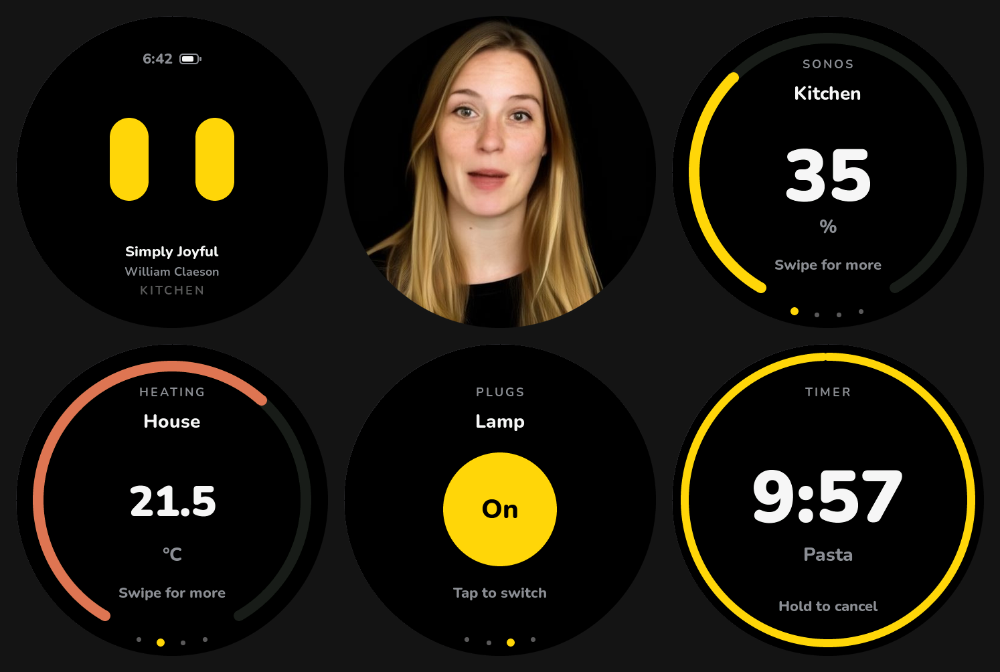

# Pucksley

A voice assistant you can hold: the round **Waveshare ESP32-S3-Touch-AMOLED-1.75C** "puck" listens with
its own microphones, answers out loud on its own speaker, and shows the conversation on its round
screen. Behind it, the **Pucksley hub** runs Claude with tools, so the same conversation can answer
questions, search the web, and run the house: Sonos rooms and Spotify, the TV, smart plugs, Home
Assistant, the underfloor heating, timers and reminders, and the Windows PC.

The puck needs no PC. It joins your Wi‑Fi and finds the hub on the network. The hub runs around the
clock in Docker on the NAS (or as a tray app on the PC). When no hub is reachable at all, the puck
still answers questions: it calls Claude and a cloud speech service itself (**direct mode**). The
PC app can lend the NAS hub just this PC's controls.

```
 ┌──────── the puck (ESP32-S3, ESP-IDF) ────────┐   Wi-Fi: WebSocket   ┌──────────── Pucksley hub (.NET 10) ─────────────┐
 │ mics → 16 kHz audio ───────────────────────▶ │ ───────────────────▶ │ voice: end-of-speech → speech-to-text           │
 │ speaker ◀── streamed speech                  │ ◀─────────────────── │ Claude (tools, web search) → text-to-speech     │
 │ round screen: assistant · home · controls ·  │   or USB (setup)     │ plugins: Sonos · Spotify · TV · plugs · HA ·    │
 │ timer · status · confirm · setup             │                      │ heating · weather · timers · memory · MCP ·     │
 │ dial · touch · lift-to-talk                  │                      │ custom actions · this PC (Windows)              │
 └──────────────────────────────────────────────┘                      │ web page: setup, plugins, chat, voice test      │
                                                                        └──────────────────────────────────────────────────┘
```



## What it does

| On the puck | What happens |
|---|---|
| **Tap** (or **lift it up**) and talk | It listens (the rings follow your voice), notices when you stop, and answers out loud. Put it down to send early. |
| Tap while it's thinking or talking | Interrupts, and listens again. Hold to cancel. |
| It asks you something | It keeps listening for your answer, no tap needed. |
| Turn while it talks | The speaker volume. |
| **Home** face | What's playing in the room this puck is in (Sonos room, Spotify or the PC). Turn for volume, tap to play or pause, swipe for the next or previous track, hold to mute. |
| **Controls** face | Dials from the plugins: a Sonos room's volume, the heating setpoint, a lamp, "TV off". |
| **Timer** face | Timers you set by voice count down here; turn and tap to set one by hand. |
| Something drastic ("shut down the PC") | The puck asks first: turn for Yes or No, then tap. |
| **Side button** | Picks a face (Assistant, Home, Controls, Timer, Status, and three toys). Hold it to power off. |

Things to try: *"What's the weather doing this afternoon?"*, *"Play Massive Attack in the kitchen."*, *"Turn
the lounge down a bit."*, *"Group the kitchen with the study."*, *"Set a timer for pasta, ten minutes."*,
*"Remind me at five to call Mum."*, *"Turn the heating up half a degree."*, *"Turn off the downstairs TV."*,
*"Add milk to the shopping list."*, *"What's on my screen?"*, *"Switch the PC to my headphones."*,
*"Remember that the bins go out on Tuesday nights."*

## Where things run

| What | Needs | Why |
|---|---|---|
| Questions, conversation, web search | the internet only | Claude is a cloud service. With no hub the puck asks it directly. |
| Spotify | the internet only | Spotify's Web API plays on any Connect device, Sonos speakers included. Runs on the hub. |
| Underfloor heating | the internet only | Your UFH controller is an Azure API. Runs on the hub. |
| Weather, timers, reminders, memory | the internet / the hub | Runs on the hub. Timers set on the puck's Timer face work with no hub too. |
| Sonos rooms, grouping, volume, TV input | **a hub at home** | Sonos is controlled on the local network (its cloud API would need a Sonos developer app). |
| Shelly relays, Kasa/Tapo plugs | **a hub at home** | Local HTTP (Shelly Cloud exists, but it's slower and rate-limited). |
| Samsung / LG TV | **a hub at home** | The local remote-control connection, plus Wake-on-LAN to turn it on. |
| Home Assistant | **a hub at home** | Its local address (unless you have Nabu Casa). |
| The PC: volume, apps, media, power | **the PC app** | Only the PC can do these. |
| Local Whisper / Piper speech | **a hub** | They run on the hub's CPU. |

So the recommended setup is: **the hub on the NAS** (always on), **the pucks** (they fall back to
direct mode if the NAS is off), and **the PC app** sharing only the PC's controls with the NAS hub.

## Setting it up

### 1. Run the hub

On the PC: `dotnet run --project hub/src/Hosts/Pucksley.Tray`, or build it with `./scripts/build.ps1`
and run `dist/Pucksley/Pucksley.exe`. A tray icon appears and the hub's page opens at
<http://127.0.0.1:8765>. (From another computer, use the link with `?key=` that the tray menu and
the log show.)

In the page:

- **Assistant**: paste your Anthropic API key. The model defaults to `claude-opus-5-5` at low effort,
  which keeps spoken answers quick.
- **Voice**: choose how it hears you and how it speaks.
  - Recommended (the same pair as Maths Tutor): **Deepgram** (Nova-3) to hear you and **Azure** to
    speak, with Australian `en-AU-AnnetteNeural` as the default voice. Add their keys on the
    Plugins page, then pick them here. Both also work in direct mode.
  - *Speech recognition*: **Whisper (on this computer)** works without a key; it downloads its model
    (142 MB) on first use, but it's slow on a NAS's CPU. **Deepgram** is fast and accurate on short
    commands; list names it might mishear (rooms, people, places) under *Names to listen for*.
    OpenAI (or Groq through it), Azure and ElevenLabs are there too.
  - *Voice*: **Windows voices** work immediately, but OpenAI, ElevenLabs and **Azure** sound far better.
    Azure also has New Zealand voices (`en-NZ-MollyNeural`, `en-NZ-MitchellNeural`).
  - Use **Talk** in the page to try the whole loop with your browser's microphone before the puck is
    set up.
- **Household**: where you live (for weather and local answers), the time zone, and a few lines
  about the home (who lives here, which speaker is where). Claude reads them on every question.

### 2. Flash the puck (ESP-IDF 5.5)

```powershell
cd firmware
idf.py set-target esp32s3        # once
idf.py -p COM5 flash             # replace COM5; hold BOOT while plugging in if it won't enter download mode
```

To keep a copy of what's on the board first (all 16 MB):
`python -m esptool --chip esp32s3 --port COM5 read_flash 0 0x1000000 board-backup.bin`.

### 3. Get it on Wi‑Fi and approved

- **Plugged into the hub PC by USB:** the hub trusts it straight away, and it appears in the page under
  **Pucks**. Use *Wi‑Fi setup over USB* there to send it your network. It joins, finds the hub on its
  own (mDNS), and switches to Wi‑Fi.
- **Without a PC:** a puck with no Wi‑Fi opens its own network, **Puck‑XXXX**. Join it from your phone
  (the puck shows a QR code) and the setup page opens; otherwise go to 192.168.4.1. Pick your
  network, type the password, and the puck joins it and finds the hub. The puck then shows a three-digit
  code, and the hub's page asks you to approve it with the same code.

Give each puck a **name** and a **room** in the page: "turn the music down" from the kitchen puck
then means the kitchen speaker.

## Plugins

| Plugin | Setup | Notes |
|---|---|---|
| **Sonos** | Nothing: finds your speakers on the LAN | Rooms, volume, grouping, favourites, TV and line-in, sleep timer, announcements, Spotify on Sonos. Single Spotify *tracks* on Sonos need your Sonos Spotify account number: add any Spotify playlist to Sonos Favourites once, and the hub learns it. |
| **Spotify** | Create an app at [developer.spotify.com](https://developer.spotify.com/dashboard) (Web API), add the redirect URI shown on the plugin's card (`http://127.0.0.1:8765/plugins/spotify/callback`), paste the Client ID, then click **Connect** | Search and play anything on any device, including Sonos rooms. Also queue, like, shuffle, transfer, and "what was that song?". Needs Premium. |
| **Smart TVs** | Add the TV (type, IP, MAC for power-on) and click **Pair**; accept on the TV | LG webOS, Samsung (Tizen), Roku. One was found on your LAN: "[TV] Downstairs Samsung" at 192.168.1.18. |
| **Smart plugs** | Add each plug (type and IP); Tapo/Kasa need your TP-Link login | Shelly (Gen1 to Gen3), TP-Link Kasa, Tapo, or any on/off URL. Seven Shelly Gen3 relays were found on your LAN; name them here. |
| **Home Assistant** | URL and a long-lived access token | Find and control anything, scenes and scripts, plus "ask Home Assistant" for whatever the tools don't cover. |
| **Underfloor heating** | Your UFH API URL and a token | Status, the house setpoint (or a change relative to it), zone overrides and offsets, history. The API takes Clerk JWTs: give the dashboard's JWT template a long lifetime, then in the dashboard's browser console run `await Clerk.session.getToken({ template: '<template name>' })` and paste the result. |
| **Weather** | Uses the household location | Open-Meteo, no key. Now, hourly and 7-day. |
| **Timers** | – | Timers, alarms (repeating too) and reminders, spoken and shown on the puck that set them. |
| **Orca** (hub on the PC running Orca) | – | Your coding-agent sessions: "anything waiting on me?", what's running and done. A banner and chime when a session starts waiting on you or finishes, and an "Agents" tile (press it to hear who needs you). Reads Orca's `orca` command-line tool every few seconds. |
| **Memory & lists** | – | "Remember that…" (always in Claude's context), plus shopping and to-do lists. |
| **Custom actions** | Define them on the plugin's card | No-code tools: call a URL (webhooks, Node-RED, IFTTT…) or run a script, with parameters. |
| **MCP servers** | Add a command or URL | Any Model Context Protocol server's tools become Claude's tools. |
| **This PC** / **PC audio** (Windows hub only) | – | Volume, media keys, now playing, audio outputs, per-app volume, open apps and files, lock/sleep/shutdown (asks first), screenshot ("what's on my screen?"), clipboard, typing, dark mode. |
| **Speech engines** | API keys on their cards | Deepgram (hearing), Azure, OpenAI (and compatible: Groq, local Speaches/Kokoro), ElevenLabs, local Whisper, Piper, Windows. |
| **Talking face (Openspline)** | [Openspline](https://docs.openspline.dev/get-started/self-host) on a PC with an NVIDIA GPU | While Pucksley speaks, the puck shows a face animated live to the voice (about 24 frames a second, over Wi-Fi). Pick one of 20 faces on the plugin's page, or give it your own picture (front-on, looking at the camera, black background). A start command lets the hub run Openspline itself. Without it the puck keeps its usual face. |

Writing your own: see [docs/PLUGINS.md](docs/PLUGINS.md). A plugin is a C# class whose methods carry `[Tool]`
attributes. Drop the DLL into the hub's `plugins` folder; for anything simpler, use Custom actions or an
MCP server.

## The hub on the NAS (Docker)

```bash
docker compose -f hub/docker-compose.yml up -d --build
```

Host networking is required (mDNS, Sonos discovery). Settings live in `hub/pucksley-data/`. On a
Synology with an Intel/AMD CPU (the "plus" models) the image runs as is: in Container Manager, create
a project from `hub/docker-compose.yml`. The container has everything except the Windows plugins.

### The PC's controls, with the hub on the NAS

1. On the PC, run the tray app. In its page (**Household → More than one hub**): turn off **Pucks
   connect to this hub**, turn on **Share this hub's tools**, and list `pc-audio` and `pc` under
   **Only these plugins**. Turn off the plugins you don't need on the PC (Sonos and the rest run on
   the NAS). The page then shows an address (`http://<PC>:8765/mcp`) and a key line.
2. On the NAS hub's page: **Plugins → MCP servers → add a server**: name `pc`, transport `http`,
   that address, and the key line under **Headers**.
3. Allow the tray app through Windows Firewall when Windows asks (private networks). Give the PC a
   fixed address in the router so the link keeps working.

Claude on the NAS hub then sees the PC's tools (as `mcp_pc_…`); anything drastic, like shutting the
PC down, is still confirmed on the puck.

## When the hub is off (direct mode)

With an Anthropic key and a cloud speech service set up on the hub (**Voice**: Deepgram, OpenAI,
Groq through OpenAI speech, ElevenLabs or Azure), the hub gives each puck a copy when it connects over Wi-Fi.
From then on, if the puck can't reach a hub, tapping still works: it listens, transcribes through
the cloud, asks Claude (with web search) and answers in the cloud voice. The idle face says
*No hub · questions only*, and the Status face *talking to Claude directly*. Home control, music
and the PC wait for the hub. Settings: **Assistant → When the hub is off**.

The keys are kept in the puck's flash and travel over your local network, so use keys you can revoke
(an Anthropic key with a spending limit, say). Local Whisper and Piper can't be used this way: they
only run on the hub.

## Repository layout

| Path | What |
|---|---|
| `docs/PROTOCOL.md` | The puck ⇄ hub protocol (JSON over WebSocket or USB serial, plus 16 kHz audio) |
| `docs/PLUGINS.md` | How to write plugins |
| `docs/ARCHITECTURE.md` | How the pieces work inside |
| `firmware/` | ESP-IDF project. `main/hal` = board (display, touch, motion, power, the ES8311 speaker codec and ES7210 mic ADC); `main/hub` = Wi-Fi, mDNS, WebSocket, USB, setup portal, protocol; `main/ui` = the faces; `components/` = vendored SensorLib and XPowersLib; `tools/sim` = desktop renderer of the faces |
| `hub/src/Pucksley.Sdk` | The plugin SDK |
| `hub/src/Pucksley.Core` | The hub: pucks, voice pipeline, Claude agent, plugin host, web API and page |
| `hub/src/Plugins/*` | Built-in plugins (Music, Home, Utility, Speech, Windows) |
| `hub/src/Hosts` | `Pucksley.Tray` (Windows tray app) and `Pucksley.Server` (console / Docker) |
| `hub/tests` | Tests for each plugin project and the core |

## Building and testing

```powershell
./scripts/build.ps1                     # dist/Pucksley (self-contained hub) + dist/firmware
dotnet test hub/Pucksley.sln              # hub tests
cd firmware; idf.py build               # firmware
cd firmware/tools/sim; ./build.sh; ./build/sim.exe   # renders every face to tools/sim/out/*.png
cd firmware/tools/test; ./run.sh        # desktop tests for the firmware's plain logic
```

## Status: what has and hasn't been checked

**Checked:**

- The firmware compiles under ESP-IDF 5.5.3 with no warnings (1.96 MB). Every face renders in the
  simulator. Direct mode's text, audio and streaming logic has desktop tests
  (`firmware/tools/test`, 67 checks).
- The hub builds, starts, and loads every plugin. About 1,200 tests pass: the core (146, with a fake
  Claude API and fake pucks end to end, direct mode setup, and tool sharing over real MCP) and every
  plugin project.
- The Docker image builds and runs on Linux x86-64 (local Whisper included).
- Run read-only against real devices: Sonos discovery and state (three rooms: an Amp with a TV, a
  One and a Move), Shelly and Samsung discovery, Windows audio and now-playing.
- Local Whisper transcribes a test clip in about half a second on this PC. Windows text-to-speech
  round-trips through speech recognition.

**Not yet checked, first things to try on the board:**

- **Never run on hardware.** The ESP-IDF port of the board layer: the I2C driver with SensorLib and
  XPowersLib, the new I2S driver, and USB Serial/JTAG.
- **The microphones.** The ES7210 setup, and which I2S slot carries them (`MIC_CHANNELS` in
  `firmware/main/config.h`).
- **The speaker.** Volume curve, and whether speech plays smoothly.
- **The connection.** Wi‑Fi joining, the setup portal, mDNS discovery of the hub, and the WebSocket.
- **Calibrations carried over from Puck for Windows.** Turn direction, touch mirroring, and display
  offsets.
- **Never called for real:** the Claude, Spotify, Home Assistant, heating and cloud speech APIs, since
  there were no keys on this machine. They're tested against fakes that check the exact requests.
- **Direct mode on the board:** the TLS connections, streaming Claude over HTTPS, the cloud voice
  through the speaker, and how much internal RAM is left (the Status line from `{"t":"diag"}` shows
  `heap=`).
- **Commands that change real devices.** None were sent, by design: play, volume, power, switching.

The puck reports which chips answered at boot to the hub's log (**Activity** page), and
`{"t":"diag"}` over its COM port prints one line of board state.

## Next steps worth doing

- On-device wake word ("hey puck") and echo cancellation using ESP-SR, now that the firmware is
  ESP-IDF, so you can talk over its answers.
- Timers by voice in direct mode (a small tool the puck runs itself).
- The PC's volume dial and now-playing on the Home face when the PC only shares its tools (sharing
  covers tools today, not dials or media sources).
- Streaming speech-to-text (live transcript on the screen while you talk).
- Over-the-air firmware updates from the hub.

## Credits

- Built on the board work in Puck for Windows.
- [LVGL](https://lvgl.io), [SensorLib and XPowersLib](https://github.com/lewisxhe) (MIT), [ArduinoJson](https://arduinojson.org), and Espressif's es7210/es8311 register sequences (Apache-2.0).
- The [Anthropic C# SDK](https://github.com/anthropics/anthropic-sdk-csharp), [Whisper.net](https://github.com/sandrohanea/whisper.net), [NAudio](https://github.com/naudio/NAudio), and the [ModelContextProtocol C# SDK](https://github.com/modelcontextprotocol/csharp-sdk).
- The [Nunito](https://github.com/googlefonts/nunito) typeface (SIL Open Font License).
- Espressif's [ESP-SR](https://github.com/espressif/esp-sr) echo canceller, fetched at build time
  (its own licence allows use on Espressif chips only).

## Licence

Pucksley is under the [MIT License](LICENSE): use it, change it, build and sell pucks with it;
just keep the copyright notice. The libraries it uses keep their own licences (see Credits).
